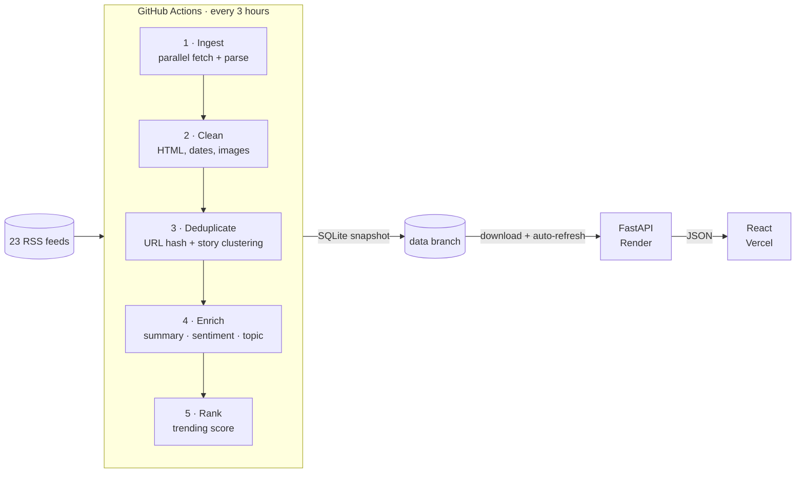

<div align="center">

# 📡 PulseWire

### AI News Intelligence Platform

Aggregates 20+ trusted news sources, groups the same story across outlets,
and adds AI summaries, sentiment and topics, all on 100% free infrastructure.

[](https://github.com/SharmaAstitva/pulsewire/actions/workflows/ci.yml)
[](https://github.com/SharmaAstitva/pulsewire/actions/workflows/pipeline.yml)


**[Live Demo](https://YOUR-APP.vercel.app)** · **[API Docs](https://YOUR-API.onrender.com/api/docs)** · **[Report a Bug](https://github.com/SharmaAstitva/pulsewire/issues)**

<!-- Add a screenshot or GIF of the app here: docs/screenshot.png -->

</div>

---

## ✨ Features

- **Automated ingestion** from 23 RSS sources (BBC, The Guardian, NPR, Al Jazeera, The Hindu, TechCrunch, Ars Technica and more), fetched in parallel every 3 hours
- **Story clustering:** when several outlets cover the same event, readers see it once, with a "covered by N sources" signal and links to every version
- **AI enrichment:** 2–3 sentence summaries, three-class sentiment (positive, neutral, negative) and topic classification
- **Trending score** that blends recency, source credibility, topic momentum and cross-outlet coverage
- **REST API** with pagination, filters, full-text search, per-client rate limiting and interactive Swagger docs
- **Editorial-style React frontend** with search, topic filters, a sentiment pulse and article pages
- **Pipeline observability:** every run is logged with counts, failures and duration, exposed at `/api/health`

## 🏗️ Architecture



### Why the pipeline runs on GitHub Actions, not the web server

The three AI models together need several GB of memory, while free web hosting tiers offer around 512 MB
and put idle servers to sleep, which would also stop any in-process scheduler. So the work is split:

| Component | Runs on | Job |
|---|---|---|
| Pipeline | GitHub Actions (scheduled) | Heavy lifting: fetch, AI models, ranking. Publishes a SQLite snapshot to the `data` branch |
| API | Render free tier | Lightweight: downloads the latest snapshot, refreshes it every 30 min, serves JSON |
| Frontend | Vercel | Static React app calling the API |

The result is a system that costs nothing to run and never runs out of memory.

## 🧠 How the intelligence works

**Deduplication in two layers.** Exact duplicates are caught by a SHA-256 hash of the normalised URL
(tracking parameters like `utm_source` are stripped first). Different outlets covering the same event are
caught by comparing title keywords (Jaccard similarity on stemmed, stop-word-filtered tokens) against stories
from the last 48 hours. The threshold is deliberately conservative: merging two different stories is worse
than showing one twice. Duplicates reuse the original's analysis, which also saves AI compute.

**AI enrichment** has two interchangeable backends:

| Task | `transformers` backend (production) | `lite` backend (tests, local dev, fallback) |
|---|---|---|
| Summary | `t5-small` (or an LLM via Groq if `GROQ_API_KEY` is set) | Extractive: leading sentences |
| Sentiment | `cardiffnlp/twitter-roberta-base-sentiment-latest` (3 classes) | Lexicon scoring |
| Topic | Zero-shot `typeform/distilbart-mnli-12-3` | Keyword scoring |

If the models fail to load, the pipeline falls back to `lite` instead of failing the run.

**Trending score**

```
score = 0.50 × recency      exponential decay, 12-hour half-life
      + 0.20 × authority    per-source credibility weight (feeds.json)
      + 0.15 × topic heat   topic's share of the last 24 hours of stories
      + 0.15 × coverage     how many outlets covered the story (log scale)
```

## 🛠️ Tech Stack

| Layer | Technologies |
|---|---|
| Pipeline | Python, feedparser, BeautifulSoup, HuggingFace Transformers, PyTorch (CPU) |
| Backend | FastAPI, SQLAlchemy 2.0, SQLite, Pydantic |
| Frontend | React 18, Vite, Tailwind CSS, TanStack Query, React Router |
| DevOps | GitHub Actions (CI + scheduled pipeline), Docker, Render, Vercel |
| Quality | pytest, Vitest, React Testing Library, Ruff (107 tests, 96% coverage) |

## 🚀 Run it locally

**Prerequisites:** Python 3.11+ and Node.js 20+

```bash
git clone https://github.com/SharmaAstitva/pulsewire.git
cd pulsewire

# 1. Backend
cd backend
python -m venv .venv
source .venv/bin/activate          # Windows: .venv\Scripts\activate
pip install -r requirements.txt
python -m pipeline.run             # fetches real news (~1 min, lite AI backend)
uvicorn app.main:app --reload      # API at http://localhost:8000/api/docs

# 2. Frontend (new terminal)
cd frontend
npm install
npm run dev                        # app at http://localhost:5173
```

To use the real AI models locally:

```bash
pip install torch --index-url https://download.pytorch.org/whl/cpu
pip install -r requirements-ml.txt
python -m pipeline.run --ai transformers
```

Or run everything with Docker: `docker compose up`

## 📚 API Reference

Interactive docs are served at `/api/docs`.

| Endpoint | Description |
|---|---|
| `GET /api/v1/articles` | Paginated stories. Params: `page`, `limit` (≤50), `category`, `sentiment`, `source`, `sort` (`trending` or `recent`) |
| `GET /api/v1/articles/{id}` | One story with topic scores and every outlet that covered it |
| `GET /api/v1/trending` | Top stories by trending score. Params: `limit` (≤20), `category` |
| `GET /api/v1/categories` | Topics with story counts and average sentiment |
| `GET /api/v1/search?q=` | Full-text search across titles, summaries and content |
| `GET /api/v1/sources` | News sources with fetch and error statistics |
| `GET /api/health` | Database status, latest pipeline run and snapshot sync state |

## 🧪 Testing

**107 automated tests** (78 backend, 29 frontend), split into unit and integration layers, with 96% line
coverage on both. New features and bug fixes were built test-first (TDD), which caught real bugs, including
rate limiting that had silently stopped working. Details in [docs/TESTING.md](docs/TESTING.md).

```bash
cd backend && pip install -r requirements-dev.txt && pytest     # or: pytest -m unit / -m integration
cd frontend && npm install && npm test
```

Integration tests run the pipeline as a real subprocess fetching feeds from a local HTTP server, sync
database snapshots from a server that supports ETags, and render the whole React app with only the network
faked. Everything runs offline with no API keys.

## ☁️ Deployment

1. **Push to GitHub** (the repo must be public so the API can download the snapshot).
2. **Run the pipeline:** Actions tab → *News Pipeline* → *Run workflow*. It creates the `data` branch.
   *Optional:* add a `GROQ_API_KEY` repository secret for LLM summaries.
3. **Deploy the API on Render:** New → Blueprint → select this repo (uses `render.yaml`). Set
   - `DATA_URL` = `https://raw.githubusercontent.com/SharmaAstitva/pulsewire/data/pulsewire.db`
   - `CORS_ORIGINS` = your Vercel URL
4. **Deploy the frontend on Vercel:** import the repo, set the root directory to `frontend`, and set
   `VITE_API_URL` to your Render URL.

> Note: GitHub pauses scheduled workflows in repositories with no activity for 60 days. Any commit re-enables it.

## 📁 Project Structure

```
pulsewire/
├── backend/
│   ├── app/                 # FastAPI service
│   │   ├── api/             # articles, trending, categories, search, sources, health
│   │   ├── data_sync.py     # downloads + hot-swaps the published snapshot
│   │   ├── models.py        # SQLAlchemy models
│   │   └── schemas.py       # Pydantic response models
│   ├── pipeline/            # ingest → clean → dedup → enrich → rank
│   │   └── run.py           # orchestrator (python -m pipeline.run)
│   ├── tests/
│   │   ├── unit/            # pure functions, no DB or network
│   │   ├── integration/     # real DB, HTTP, local servers, CLI subprocess
│   │   └── fixtures/        # recorded RSS feeds
│   └── feeds.json           # news sources and credibility weights
├── frontend/                # React + Vite + Tailwind
│   └── src/__tests__/       # Vitest unit + integration tests
├── docs/TESTING.md          # testing strategy and TDD log
├── .github/workflows/       # CI and the scheduled pipeline
├── docker-compose.yml
└── render.yaml
```

## 🗺️ Roadmap

- [ ] Semantic story clustering with sentence embeddings
- [ ] Personalised "For You" feed based on reading history
- [ ] Daily email digest of top stories
- [ ] Named-entity pages (people, companies, places)
- [ ] Migrate storage to PostgreSQL when traffic requires concurrent writes

## 👤 Author

**Astitva Sharma**: [LinkedIn](https://linkedin.com/in/sharmaastitva) · [GitHub](https://github.com/SharmaAstitva)

Licensed under the [MIT License](LICENSE).
